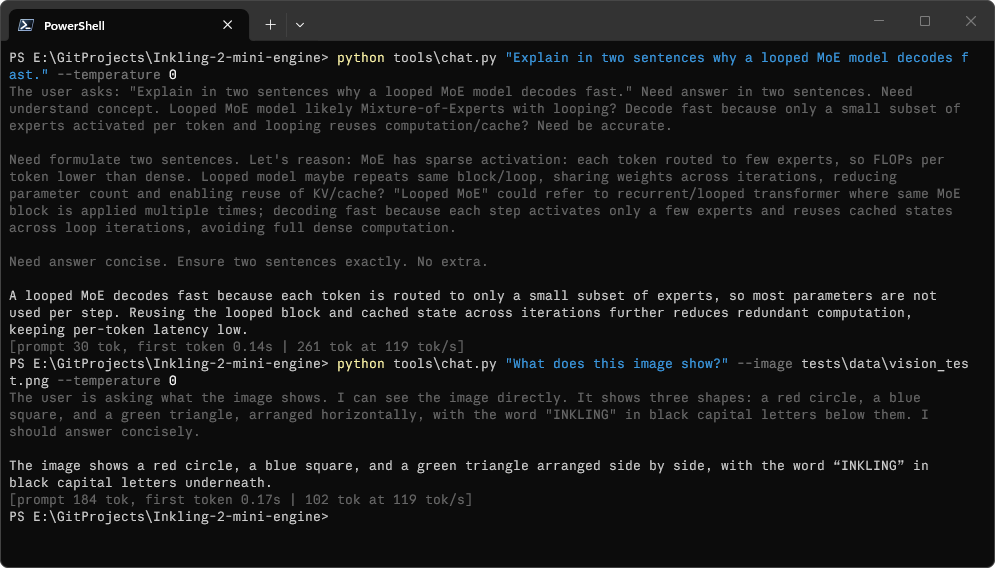

# InklingEngine

A from-scratch inference engine for **Inkling 2 Mini** (Thinking Machines Lab) on NVIDIA GPUs: a Rust host, hand-written
CUDA kernels, and nothing else. It runs the Unsloth GGUF directly (weights are repacked on load), serves an
OpenAI-compatible API with reasoning, tool calls and image input, and fits a 256k-token context in 24 GB.

It is built for this one model. That focus is why it is fast: the looped 48-pass schedule, the depth attention,
the short convolutions and the NVFP4 experts each get fused, specialized kernels.

> InklingEngine is an independent inference engine optimized for Thinking Machines Lab's Inkling 2 Mini model. It is
> not affiliated with or endorsed by Thinking Machines Lab.



## Performance

RTX 3090 (24 GB), `Inkling-2-Mini-UD-Q4_K_XL.gguf`, single stream:

| | llama.cpp (Unsloth b12588) | **InklingEngine** |
|---|---|---|
| Decode | 47–50 tok/s | **113–117 tok/s** (flat from 256 to 4k tokens of context) |
| Prefill, 512-token prompt | ~1,350 tok/s | **3,100 tok/s** |
| Prefill, 2k / 8k-token prompt | | **4,350 / 4,190 tok/s** |
| Context in 24 GB | 32k uses ~22 GB (q8_0 KV) | **262,144** (6-bit KV) |
| Decode at 32k / 131k / 262k depth | | 97 / 68 / 45 tok/s |
| Image encode, 1280×1280 (1,024 tokens) | | 116 ms |

### How correctness is checked
Logits are compared against the reference llama.cpp implementation on the same GGUF. On an 807-token prompt with
batched prefill:
- median KL divergence is 6e-5;
- top-1 agreement is 97%;
- the mean KL (~0.018) comes almost entirely from router near-ties that flip an expert choice.

The vision encoder's projected embeddings match `llama-mtmd-debug` to about ±0.002, the difference between f16 and
F32 GEMMs.

### KV cache format
The KV format was chosen by measurement, not assumed (`inkling kvstudy`). 6-bit K/V on the 8 full-attention passes
costs only +0.0006 mean KL over 8-bit, while the sliding-window passes keep f16. The forward pass is specified
in [docs/MODEL.md](docs/MODEL.md).

## Requirements

- **GPU:** NVIDIA, compute capability 7.5 or newer (Turing / RTX 20xx through Blackwell / RTX 50xx), with enough
  memory for the weights plus the context:

  | context | VRAM used by the engine |
  |---|---|
  | 8k | ~18.3 GiB |
  | 32k | ~18.6 GiB |
  | 128k | ~19.8 GiB |
  | 256k | ~21.4 GiB |
  | + vision (`--mmproj`) | +0.7 GiB (+ up to 0.4 GiB while encoding a large image) |

  A 24 GB card runs the full 256k context; a 20 GB card should fit about 64k (untested). There is no CPU offload.
- **Driver:** a recent NVIDIA driver with CUDA 12.8+ support. Only the driver is needed to run; the toolkit is
  needed only to build.
- **Model files:** from [unsloth/Inkling-2-Mini-GGUF](https://huggingface.co/unsloth): `Inkling-2-Mini-UD-Q4_K_XL.gguf`
  and, for images, `mmproj-F32.gguf`. Only UD-Q4_K_XL has been tested.
- **To build:** Rust 1.85 or newer, and the CUDA Toolkit 12.x (`nvcc` on PATH or `CUDA_PATH` set).

Tested on Windows 11 with an RTX 3090. The code has no Windows-specific parts, but Linux builds have not been tested
yet. The sm_75 code paths were validated by running the compute_75 PTX on the 3090.

## Quick start

InklingEngine is one program, `inkling`. You build it from source with Cargo; there are no prebuilt downloads yet.

**1. Install the prerequisites** (see [Requirements](#requirements)):
- an NVIDIA driver;
- the [CUDA Toolkit 12.x](https://developer.nvidia.com/cuda-downloads): check with `nvcc --version`;
- [Rust](https://rustup.rs): check with `cargo --version`.

**2. Get the code and install the `inkling` command:**

```sh
git clone https://github.com/ManyGlue0/InklingEngine.git
cd InklingEngine
cargo install --locked --path crates/inkling-cli
```

This compiles everything, CUDA kernels included (a few minutes the first time), and copies `inkling` to Cargo's bin
folder: `~/.cargo/bin`, or `%USERPROFILE%\.cargo\bin` on Windows. Rustup puts that folder on your PATH, so open a new
terminal and check:

```sh
inkling --version
```

If you would rather not install it, run `cargo build --release` instead and call the binary by its path,
`target/release/inkling`.

**3. Download the model** from [unsloth/Inkling-2-Mini-GGUF](https://huggingface.co/unsloth):
`Inkling-2-Mini-UD-Q4_K_XL.gguf`, plus `mmproj-F32.gguf` if you want image input.

**4. Run it:**

```sh
# OpenAI-compatible server at http://127.0.0.1:8080/v1 (point any OpenAI client or chat UI at it)
inkling serve path/to/Inkling-2-Mini-UD-Q4_K_XL.gguf --mmproj path/to/mmproj-F32.gguf --ctx 131072

# or a one-off generation in the terminal (greedy by default; see "Environment" for sampling)
inkling generate path/to/Inkling-2-Mini-UD-Q4_K_XL.gguf "The three largest moons of Jupiter are" 64
```

Running `inkling` with no arguments lists every command.

### Build options

The kernels are compiled into the binary.
- **Default (`native`):** builds only for the GPUs in the build machine, which is fastest.
- **Portable:** a binary for every supported architecture, sm_75 to sm_120, plus PTX for future GPUs:

```sh
INKLING_CUDA_ARCHS=75,80,86,89,90,100,120 cargo install --locked --path crates/inkling-cli
```

On Windows PowerShell, set the variable first: `$env:INKLING_CUDA_ARCHS="75,80,86,89,90,100,120"`.
`nvcc` must be on PATH, or `CUDA_PATH` set (the CUDA installer does this).

## Server

Server flags:

| flag | default |
|---|---|
| `--host`, `--port` | `127.0.0.1`, `8080` |
| `--ctx N` | `131072` (max 262144 on 24 GB) |
| `--mmproj FILE` | none (enables image input) |
| `--api-key KEY` (or `INKLING_API_KEY`) | none |
| `--model-id NAME` | the file name |
| `--temp`, `--top-p`, `--top-k`, `--min-p` | `0.8`, `0.95`, `40`, `0.05` |
| `--repeat-penalty`, `--repeat-last-n` | `1.0`, `64` |

### API

- `POST /v1/chat/completions`, streaming (SSE) or not. It renders the model's own chat template natively (output
  identical to its Jinja template) and returns:
  - the reasoning in `reasoning_content` and the answer in `content`;
  - tool calls in `tool_calls`, with `finish_reason: "tool_calls"`.
- **Request fields:**
  - `tools` and `tool_choice: "none"`;
  - `reasoning_effort` (`none`/`low`/`medium`/`high`/`max` or a number in 0–0.99; default 0.9);
  - `max_tokens` / `max_completion_tokens`, `stop`, `seed`, `stream_options.include_usage`;
  - sampling: `temperature`, `top_p`, `top_k`, `min_p`;
  - penalties: `presence_penalty`, `frequency_penalty`, `repeat_penalty` (or `repetition_penalty`), `repeat_last_n`.
- **Images:** content parts of type `image_url`, `input_image` or `image`, carrying a `data:` URL or bare base64
  (PNG, JPEG, WebP, GIF, BMP). Remote URLs are not fetched.
  - An image becomes up to 4,096 tokens: one per 40×40 pixels.
  - Larger images are downscaled with the aspect ratio kept.
- `POST /v1/completions`: raw text completion; `prompt` is a string or an array of token ids.
- `GET /v1/models`, `GET /health`.
- **Prompt caching:** a request that extends the previous conversation reuses its state, including images, and the
  reused count is reported in `usage.prompt_tokens_details.cached_tokens`.
- **CORS** is open, so browser UIs work. Requests are served one at a time, in order.

```sh
curl http://127.0.0.1:8080/v1/chat/completions -H "Content-Type: application/json" -d '{
  "messages": [{"role": "user", "content": "Write a haiku about GPUs."}],
  "reasoning_effort": "low", "stream": true }'
```

Try it from a terminal with the bundled client: `python tools/chat.py "Hello!"` (add `--image photo.jpg` for vision).
Smoke tests: `python tools/server_smoke.py` (tool-call round trip) and `python tools/vision_smoke.py` (image input).

### Environment

| variable | effect |
|---|---|
| `INKLING_KV=f16` | f16 KV cache on the full-attention passes instead of 6-bit (~2.5× the KV memory) |
| `INKLING_TEMP`, `INKLING_TOP_P`, `INKLING_TOP_K`, `INKLING_MIN_P`, `INKLING_SEED` | sampling for `inkling generate` |
| `INKLING_REPEAT_PENALTY`, `INKLING_PRESENCE_PENALTY`, `INKLING_FREQUENCY_PENALTY`, `INKLING_REPEAT_LAST_N` | penalties for `inkling generate` |
| `INKLING_CUDA_ARCHS` | build time: target architectures (default `native`) |

Developer commands:
- **Benchmarks:** `bench`, `benchpp`, `benchctx`.
- **Correctness:** `validate` against reference dumps, `kvstudy`, `cachetest`, `rendertest`, `gemmtest`, `visiontest`.

## How it works

- **Decode.** One CUDA graph per token, with sampling on the GPU. The device runs the autoregressive loop and the
  host only reads tokens from mapped memory. Per pass there are about a dozen fused kernels:
  - depth-attention mix + norm + int8 quantization;
  - a multi-segment Q8 matvec on dp4a;
  - split-K flash-decoding with the relative-position bias and the attention sink computed on the fly;
  - a persistent fused MoE kernel: NVFP4 gate_up → grid barrier with prefetched down weights → down + combine +
    short conv + residual.

  The kernels issue all of their loads up front, so small weights that miss L2 every token do not serialize on
  DRAM latency.
- **Prefill.** Chunks of 2,048 tokens on int8 tensor cores (Q8 weights, per-row-quantized activations), with grouped
  expert GEMMs and device-side routing. Flash attention runs on f16 tensor cores with banded relative bias.
- **Long context.** Only the 8 full-attention passes keep a full KV cache, in 6-bit: 104 bytes per head per position.
  The 40 sliding-window passes keep f16 rings of window + chunk entries.
- **Vision.** Native ViT (23 layers) on f16 tensor cores: 2-D RoPE, flash attention, 2×2 patch merge and MLP
  projector. The embeddings replace the image placeholder positions during prefill.

[docs/MODEL.md](docs/MODEL.md) specifies the forward pass the kernels implement.

## Limitations

- **Single stream:** one request at a time, no batching across requests.
- **One model:** Inkling 2 Mini only, and the whole model must fit in VRAM.
- **Hardware:** NVIDIA GPUs only. Native FP4 tensor cores on Blackwell are not used yet; NVFP4 is decoded in
  software everywhere.
- **Images:** the server does not fetch image URLs.

## Credits

- **Inkling 2 Mini** by [Thinking Machines Lab](https://thinkingmachines.ai) (Apache-2.0).
- **GGUF conversion and quantization** by [Unsloth](https://unsloth.ai).
- **Reference implementation:** [llama.cpp](https://github.com/ggml-org/llama.cpp) (MIT), Unsloth's Inkling 2
  branch. It was used as the numerical reference and as the source of the model and preprocessing semantics. No
  llama.cpp code is included; its license notice is reproduced in [NOTICE](NOTICE).
- **Chat template** (`tests/data/chat_template.jinja`, a test oracle) is the model's own, from the Inkling 2 Mini
  release (Apache-2.0).

## License

[MIT](LICENSE). Third-party notices (the
llama.cpp MIT notice, the Inkling 2 chat template used as a test oracle) are in [NOTICE](NOTICE).
